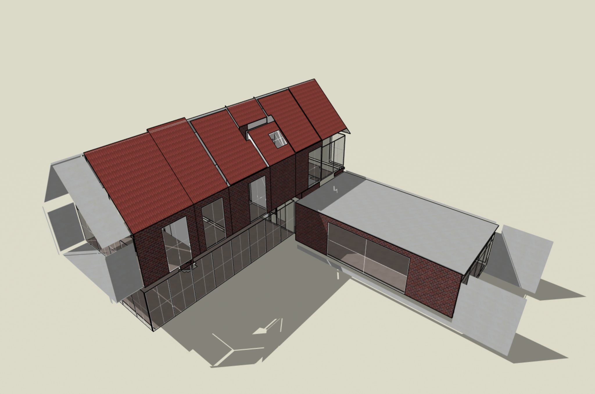
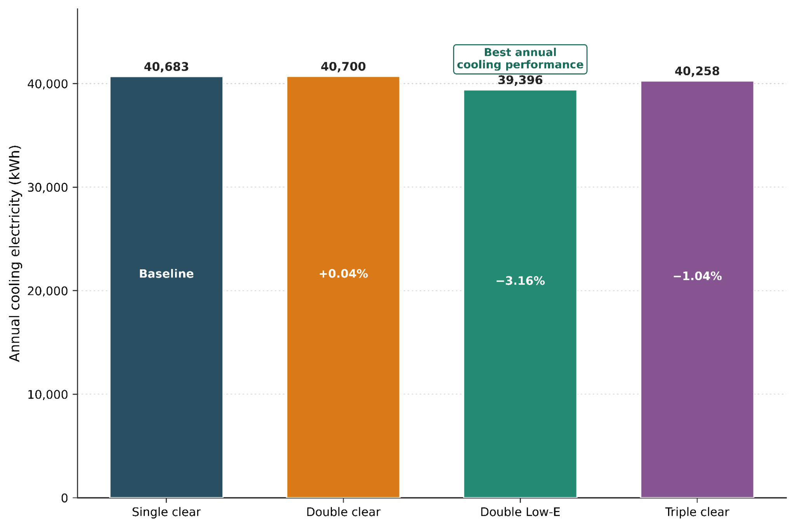
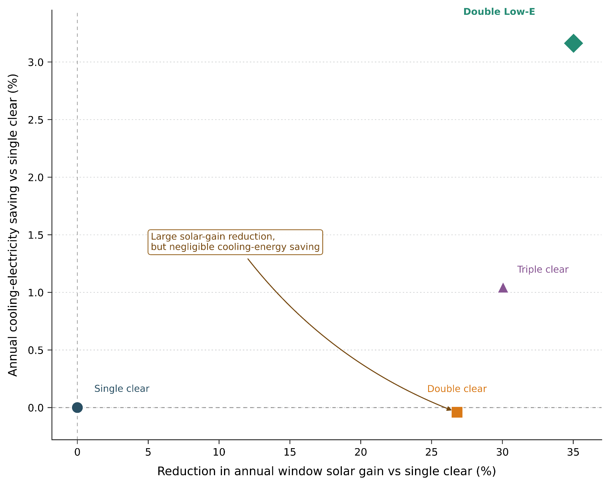

# Parametric Evaluation of Glazing Systems for Building Energy Performance

**A comparative numerical study of window glazing, cooling electricity, and solar heat gain using DesignBuilder and EnergyPlus.**

This project compares **four exterior-window glazing configurations** in the same residential building model. Building geometry, envelope constructions, schedules, HVAC settings, weather input and window layout were held constant, while only the exterior glazing template was changed. The goal was to distinguish reductions in *window solar heat gain* from actual reductions in *whole-building cooling electricity*.

<p align="center">
  
</p>

## Key results

The **double low-emissivity (Low-E)** configuration had the lowest simulated annual cooling electricity demand and the greatest reduction in solar heat gain among the four cases.

| Window glazing | Annual cooling electricity (kWh) | Electricity saving vs. baseline | Annual window solar gain (kWh) | Solar gain reduction |
| :--- | ---: | ---: | ---: | ---: |
| Single clear (baseline) | 40,683.24 | 0.00% | 125,295.25 | 0.00% |
| Double clear | 40,699.96 | -0.04% | 91,722.95 | 26.79% |
| **Double Low-E** | **39,396.43** | **3.16%** | **81,416.54** | **35.02%** |
| Triple clear | 40,258.15 | 1.04% | 87,650.23 | 30.05% |

*Source: the included [annual summary](data/annual-performance-summary.csv) and [project report](report/glazing-systems-energy-performance.pdf). All values are simulation results, not measurements.*





### Interpretation

- Double clear glazing reduced annual solar gains by **26.79%**, but cooling electricity actually increased by about **0.04%**.
- Triple clear achieved a **30.05%** solar gain reduction with only **1.04%** cooling electricity saving.
- Double Low-E achieved both the strongest solar control (**35.02%**) and the greatest cooling electricity saving (**3.16%**).
- **Solar-gain reduction is not equivalent to HVAC electricity saving.** Internal loads, conduction, ventilation, infiltration, operating schedules, and cooling equipment all contribute to the whole-building balance.

The reported mean operative temperatures were **30.42°C, 30.89°C, 30.76°C, and 30.88°C** for single clear, double clear, double Low-E, and triple clear, respectively. These are diagnostic model outputs, **not a complete occupied-hour thermal-comfort evaluation**.

## Simulation methodology

The same DesignBuilder residential model was simulated in EnergyPlus for each glazing case. The project report documents the following shared settings:

| Parameter | Common model setting |
| :--- | :--- |
| Building and envelope | Unchanged across all cases |
| External window-to-wall ratio | 30% |
| Window geometry | Preferred height: 1.50 m; spacing: 5.00 m; sill height: 0.80 m |
| External shading | Not activated |
| Occupancy template | Domestic Lounge; 0.05 person/m² |
| Infiltration | 0.5 air changes per hour; continuous |
| Cooling setpoint / setback | 24°C / 28°C |
| Heating setpoint / setback | 20°C / 15°C |
| Cooling system | Packaged DX; seasonal COP 2.5 |
| Ventilation | Natural ventilation enabled; mechanical ventilation enabled in packaged-DX template |
| Weather, schedules and internal loads | Kept the same for the four runs |

**External glazing templates** (as documented in the report):

| Case | DesignBuilder glazing definition |
| :--- | :--- |
| 01 — Single clear | `Sgl Clr 6mm`; no shading |
| 02 — Double clear | `Dbl Clr 6mm/13mm Air`; no shading |
| 03 — Double Low-E | `Dbl LoE (e2=.1) Clr 3mm/13mm Air` |
| 04 — Triple clear | `Trp Clr 3mm/6mm Air`; no shading |

The evaluation considered annual/monthly cooling electricity, total cooling-load magnitude, window solar gains, heating energy, and operative temperature. For cooling electricity, percentage saving relative to the single-clear baseline was computed as

$$
\text{Saving}(\%) = \frac{E_{\text{baseline}} - E_{\text{case}}}{E_{\text{baseline}}} \times 100
$$

Solar-gain reduction was calculated using the equivalent baseline-relative expression.

## Results and figures

All eight supplied result charts are preserved at their original resolution:

| Figure | Description |
| :--- | :--- |
| [Monthly cooling electricity](figures/analysis/monthly-cooling-electricity.png) | Seasonal cooling electricity demand |
| [Annual cooling electricity](figures/analysis/annual-cooling-electricity.png) | Whole-building cooling energy comparison |
| [Monthly solar heat gain](figures/analysis/monthly-solar-heat-gain.png) | Solar gains transmitted through exterior windows |
| [Solar reduction vs. energy saving](figures/analysis/solar-reduction-vs-energy-saving.png) | Relationship between solar control and cooling energy benefit |
| [Monthly cooling load](figures/analysis/monthly-total-cooling-load.png) | Total cooling-load magnitude by month |
| [Monthly operative temperature](figures/analysis/monthly-operative-temperature.png) | Indoor operative temperature and outdoor dry-bulb temperature |
| [Annual solar heat gain](figures/analysis/annual-solar-heat-gain.png) | Annual exterior-window solar gain comparison |
| [Normalized annual performance](figures/analysis/normalized-annual-performance.png) | Relative cooling electricity, cooling load, and solar gain |

Building geometry and the five documented construction-layer visualizations are available under [`figures/`](figures/), including [`figures/construction/`](figures/construction/). Construction compositions and layer thicknesses are detailed in the [report](report/glazing-systems-energy-performance.pdf).

## Repository structure

```text
glazing-energy-analysis/
├── README.md
├── .gitignore
├── report/
│   └── glazing-systems-energy-performance.pdf
├── models/
│   ├── single-clear.dsb
│   ├── double-clear.dsb
│   ├── double-low-e.dsb
│   └── triple-clear.dsb
├── data/
│   ├── annual-performance-summary.csv
│   └── monthly/
│       ├── single-clear.csv
│       ├── double-clear.csv
│       ├── double-low-e.csv
│       └── triple-clear.csv
└── figures/
    ├── building-model.png
    ├── analysis/          # Eight comparison charts
    └── construction/      # Five envelope construction visuals
```

The `.dsb` files are the original DesignBuilder project models. The CSV files are **original supplied exports with unchanged contents**, renamed consistently for clarity; the monthly files include a *second row specifying units* after the column-header row. Some cooling-load columns use negative values as an output sign convention; plotted *cooling-load magnitude* is positive.

## Viewing the models and reproducing the comparison

1. Open the relevant file from [`models/`](models/) in a compatible version of **DesignBuilder**.
2. Review each case's glazing template, geometry, schedules, constructions, HVAC configuration, and weather setup before rerunning **EnergyPlus**.
3. Use the unchanged [`data/annual-performance-summary.csv`](data/annual-performance-summary.csv) and monthly results in [`data/monthly/`](data/monthly/) for independent analysis or plotting.
4. Consult the [complete report](report/glazing-systems-energy-performance.pdf) for study inputs, interpretation, and references.

**Reproducibility note:** The original standalone weather file and exact installed DesignBuilder/EnergyPlus version information were not supplied in this repository. The `.dsb` models may retain internal project settings, but an independent exact reproduction has **not** been verified. The monthly CSVs are simulated monthly outputs; their 2002 date labels are part of the exported simulation calendar, not field measurement dates.

## Scope and limitations

- **Numerical simulation only:** no measured building electricity or instrumented thermal data are claimed.
- The results apply to the **modeled building and operating conditions**; they should not be generalized as universal glazing performance rankings.
- A complete comfort assessment, economic payback analysis, climate-sensitivity study, or independent validation was outside the reported scope.
- Original data and model binaries have been preserved; the project does not include a separate automated post-processing script.

## Report and author

**Full report:** [Parametric Evaluation of Glazing Systems and Their Influence on Building Cooling Energy and Solar Heat Gain (PDF)](report/glazing-systems-energy-performance.pdf)

**Nafiz Fuad Niloy**  
Department of Energy Science and Engineering  
Khulna University of Engineering & Technology (KUET), Bangladesh
